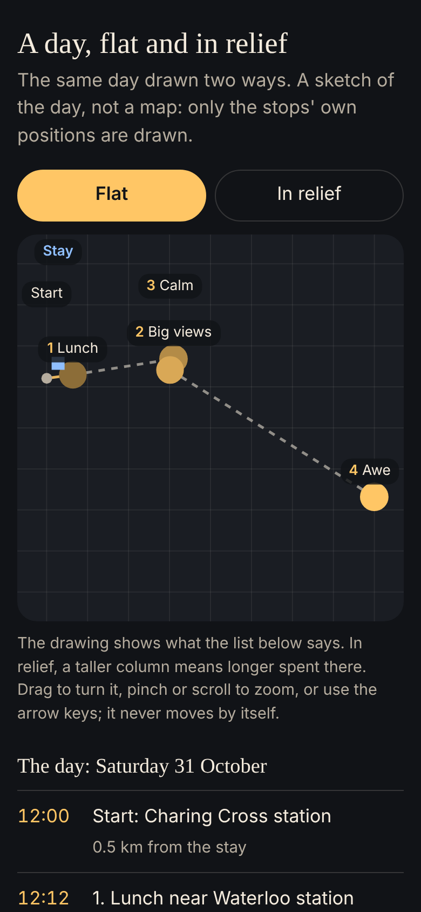
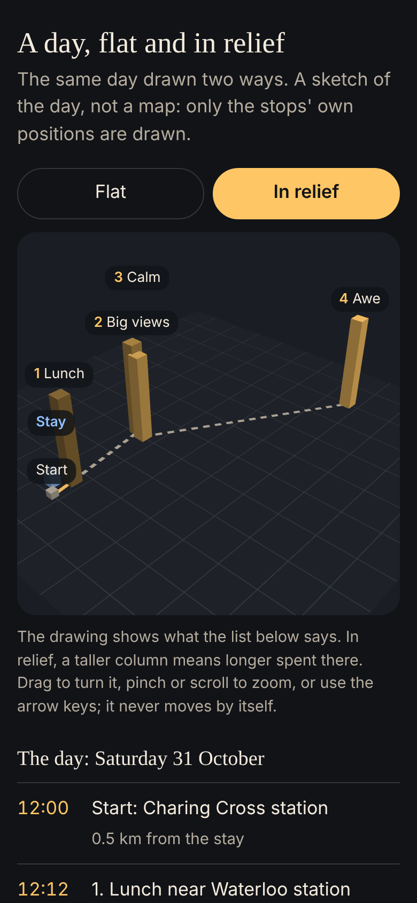

# 3D and spatial experiences (independent review, 11 Nov 2026)

**Decision.** Don't add 3D to ODYS now. I built the one experiment that could be built honestly (the app's own sample day drawn flat and "in relief", from the same numbers) and measured it: the 3D view is quick enough and small enough, **and it tells the person nothing the flat view doesn't**. Photorealistic 3D of real places is priced and licensed out of reach. AR wayfinding lost to an ordinary map in the one outdoor field study found. The spatial work that would help travellers is in two dimensions: **Android's map needs a new tile source before any public release**, and "where is my stay relative to my days" is better answered with distances than with depth.

Research is from pages read on 11 Nov 2026 by a research assistant in this session; what could not be confirmed from a primary page is marked UNVERIFIED and listed at the end.

## The proof of concept

`prototype/day-in-relief/index.html`: one file, no libraries, no map tiles, no network. It draws the bundled sample day (four stops from Waterloo to Greenwich, and a sample stay) two ways. It is a sketch of the day, not a model of London: only the stops' own coordinates are drawn, so it makes no claim about the real place that could be wrong.

| Flat | In relief |
|---|---|
|  |  |

| Measured (headless Chromium, a 390 × 844 screen at 2×) | Flat | In relief |
|---|---|---|
| One drawing | 0.5 ms | 7.1 ms |
| One drawing with the processor slowed 4× | 2.0 ms | 10.7 ms |
| First drawing after opening | 49 ms (94 ms slowed), one file for both | the same file |
| Size | 18.7 KB for both together, 7.4 KB compressed | |
| Network requests | 0 | 0 |
| Offline | Works: nothing is fetched | The same |
| Screen reader | The day is a list in words; the drawing is hidden from readers and adds nothing to it | The same |
| Motion | None | None unless the person turns it (drag, pinch, arrow keys); one drawing per change, no loop running |

Limits: headless Chromium draws WebGL in software, so 7.1 ms is a worst case for a phone with a working graphics chip; nothing here measures battery, which only a phone can; and no person was asked which view they understood better.

**What it shows:**
1. **Performance is not the objection.** Both are far inside a 16 ms frame. A schematic 3D view costs about 14 times the work of the flat one and is still cheap.
2. **The third dimension has nothing to carry.** The obvious thing to put on it is time spent. The stops last 45, 50, 45 and 50 minutes, so the columns are all but the same height.
3. **Tilting the ground misleads.** Greenwich is about 6 km from the City stops and 8 km from the stay. Flat, that is plain. Tilted, it looks a short walk away.
4. **Both views have the same real problem, and it isn't depth:** two stops 300 m apart sit on top of each other at a scale that also shows Greenwich. That is solved by zooming in on one leg at a time, which any map does and a tilt doesn't.

A fair test of understanding would take 5 to 10 people and two questions ("which stop is nearest your stay?", "what order are they in?") on each view (~3 h). I don't recommend spending those hours: the flat view answers both at a glance.

## The five ideas, judged

| Idea | What it needs | Cheapest honest way | Verdict |
|---|---|---|---|
| **1. Destination previews in 3D** | A true model of the place | Google's Photorealistic 3D Tiles: US$6 per 1,000 after 1,000 free, no storing, no offline, no deriving models from it. Apple's Look Around: free on iPhone, UK cities covered (secondary source), nothing equivalent on Android | **No.** Photos already do this, and they are licensed and in the app. If wanted later: Look Around on iPhone only, a few hours |
| **2. A journey shown in 3D** | Only the stops' coordinates | Tilt the existing Apple map; a pitched line on Android | **No.** Central London is flat; the proof of concept is this idea, and it added nothing |
| **3. Neighbourhood maps: where the stay sits against the days** | Coordinates and travel times | Already in the Brain: `stayprices.trip_fit` gives each day's distance from the stay | **Yes, in 2D.** A flat map with the days' stops and one line of words ("12 minutes from Tuesday's first stop") beats depth |
| **4. Experience previews** | A model or video of the real moment | Generated 3D models are plausible, not accurate: unusable for a real place. Scanning each place needs a visit and permission | **No.** A generated model of a real place breaks the fourth test of the quality standard (trustworthiness). Short honest video, if anything, later |
| **5. AR wayfinding from a station** | Position accurate to a metre or two; both platforms' AR; field testing | ARKit and ARCore's Geospatial API (tied to Street View coverage) | **No.** A field study with 48 people found a map and voice directions beat AR on performance and experience (Salzburg Research, via a search summary). Another found weaker route memory with AR. The card's own words for the approach ("come out of the Exhibition Road exit, turn left") are the cheap version and already exist |

## What is worth doing instead

1. **Replace Android's map tiles before any public release (~8 h).** The Android app loads tiles from `tile.openstreetmap.org`. The OSM Foundation's policy says "Commercial services … should be especially aware that access may be withdrawn at any point", and offline use of those servers is prohibited. For a test this is fine and the app identifies itself properly. For a product it is a map that can vanish, and it rules out an offline map. The route: MapLibre Native (BSD-2-Clause) drawing vector tiles from OpenFreeMap (free, no key, commercial use allowed, best-effort) or from a self-hosted Protomaps file, which can also be packaged for offline use.
2. **The stay against the days, flat (~6 h in both apps).** One map, the stay, each day's stops in that day's colour, and the sentence the Brain already computes.
3. **A text alternative for every map** (the proof of concept's list is the pattern): each map in the apps should have its stops as a list a screen reader can read.

## The tools, briefly

| Tool | Licence and cost | For ODYS |
|---|---|---|
| Three.js | MIT, free; web only | Not needed: the proof of concept used plain WebGL in under 19 KB |
| React Three Fiber | Web, React only | Irrelevant to native apps |
| glTF, USDZ | Open formats | Only useful with models, and there are none worth having |
| Apple MapKit (tilt, realistic elevation), Look Around | Free with the developer programme (an Apple forum answer; UNVERIFIED in the licence) | Already in the iPhone app; a tilt is a line of code if ever wanted |
| RealityKit, ARKit | Free; iPhone only. SceneKit is being retired in favour of RealityKit (secondary sources) | No |
| ARCore Geospatial | Price not found (UNVERIFIED); depends on Street View coverage | No |
| Google Maps SDK | Free monthly calls per product (10,000 on the basic tier), then paid; needs a billing account | Not needed |
| Google Photorealistic 3D Tiles, Maps 3D SDK | US$6 to US$7 per 1,000 after a small free amount; no offline, no caching; the 3D SDK is "no charge until November 13, 2026" | No |
| MapLibre GL JS / Native | Open source (Native: BSD-2-Clause); free | **Yes, for Android's basemap** |
| OpenStreetMap data | ODbL: credit required, share-alike on derived databases | Fine with credit |
| OpenFreeMap; Protomaps (PMTiles) | Free, commercial use allowed; self-host a single file for offline | **Yes** |
| MapTiler, Stadia | Free tiers are non-commercial; from US$20 to US$30 a month | Only if self-hosting is unwanted |
| Cesium | The free tier is non-commercial; US$149 a month and up | No |
| AI 3D generators (Meshy and others) | Cheap or free; licences vary | **No**: they invent geometry |
| Blender | The program is GPL; what you make with it is yours | Not needed |

## Evidence on 3D and AR for finding your way (weak to mixed)

- No systematic review found. A 2025 study with 60 people found 3D maps helped in some layouts and hurt in others (Frontiers in Virtual Reality). An indoor study found no significant difference between 2D and 3D maps (Li and Giudice, 2013). A 2018 study found the interactive 3D group did worse. All small, mostly indoors or in a lab.
- AR walking navigation: the Salzburg field study above; a 2021 study found weaker route memory with AR. One paper suggests an AR navigation app would empty a phone battery in under two hours (not checked: UNVERIFIED).
- No evidence was found that people value 3D or AR in a trip planner. Wanderlog, Tripadvisor and Booking.com ship none that the research could find.

## Not confirmed in this session

Three.js's current release; MapLibre GL JS's licence text; the iOS version needed for realistic elevation; ARKit's requirements; Apple's current Look Around and Flyover city lists; whether Google's 3D SDK for iPhone is generally available; ARCore Geospatial's price; the size of a London map file; the battery figure; the AI generators' terms beyond Meshy and Stability.

## Sources (read 11 Nov 2026)

- OSM tile policy: https://operations.osmfoundation.org/policies/tiles/ (the quoted sentences re-read directly by the reviewer).
- Google Maps Platform prices and the Map Tiles policy: https://mapsplatform.google.com/pricing/ , https://developers.google.com/maps/billing-and-pricing/pricing , https://developers.google.com/maps/documentation/tile/policies , https://developers.google.com/maps/documentation/maps-3d/android-sdk/usage-and-billing .
- MapLibre: https://maplibre.org/maplibre-gl-js/docs/ , https://github.com/maplibre/maplibre-native . OpenFreeMap: https://openfreemap.org/ . Protomaps: https://docs.protomaps.com/basemaps/downloads . Overture: https://docs.overturemaps.org/attribution/ . MapTiler: https://www.maptiler.com/cloud/pricing/ . Stadia: https://stadiamaps.com/pricing/ . Cesium: https://cesium.com/platform/cesium-ion/pricing/ .
- Apple: https://developer.apple.com/support/terms/apple-developer-program-license-agreement/ , https://developer.apple.com/augmented-reality/quick-look/ , https://developer.apple.com/forums/thread/654501 .
- ARCore: https://developers.google.com/ar/develop/geospatial , https://developers.google.com/ar/devices .
- Meshy: https://www.meshy.ai/pricing . Stability: https://stability.ai/license . Blender: https://www.blender.org/about/license/ .
- Studies: https://www.frontiersin.org/journals/virtual-reality/articles/10.3389/frvir.2025.1622522/full ; https://umaine.edu/vemi/?p=1238 ; https://www.salzburgresearch.at/?p=14599 ; https://informahealthcare.com/doi/full/10.1080/15230406.2021.1871646 ; WCAG on motion: https://www.w3.org/WAI/WCAG22/Understanding/animation-from-interactions.html .
