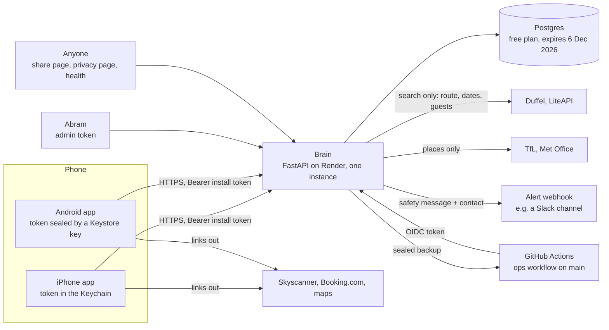

# Security audit (independent review, 11 Nov 2026)

**Decision.** Nothing found lets one person read or change another's data, and nothing found is an emergency for the friends' round (about 15 installs, nothing sold). But the Brain, as it stood on the development branch, could be **stopped or filled by one anonymous person in minutes**, and it **kept two things the app tells people it doesn't keep**. Those are fixed on this branch with tests (SEC-01 to SEC-08). The rest are choices for Abram, and three of them block a public release: the Android build's signing and target version (SEC-12, SEC-13), the iPhone privacy manifest (SEC-14) and the database that expires on 6 Dec 2026 (SEC-11).

**Readiness, plainly.** For the friends' round on `main`: acceptable, with SEC-01, SEC-02 and SEC-04 as known risks until this branch reaches `main` after the round. For strangers: only after this branch's fixes are live, plus SEC-09 to SEC-12. For a public release that takes money: not ready. This is a code review and local testing by one reviewer, **not a penetration test and not a certification**.

## What was done, and its limits

- **Read in full:** `brain/src/brain/api.py`, `ops.py`, `schemas.py`, `db.py`, `config.py`, `ghoidc.py`, `backup.py`, `notify.py`, `share.py`, `calibration.py`, the provider calls in `trips.py`, `tfl.py`, `weather.py`, `fx.py`, `stayprices.py`; the four workflows; `render.yaml`; the privacy notice. **Read in part** (the security-relevant code): the iPhone app's `BrainClient.swift`, `AppModel.swift`, `Location.swift`, `Speech.swift`, `FaceApp.swift`, `project.yml`; the Android app's manifest, backup rules, `build.gradle.kts`, `Store.kt`, `BrainClient.kt`, `Map.kt`, `Root.kt`.
- **Tested** on a throwaway local database with made-up cards (never production): a script that tries each weakness, then the fix, then a regression test (`brain/tests/test_hardening.py`, 33 tests). Tools: `pip-audit` 2.x and `bandit` on the Brain, a CycloneDX bill of materials (`decisions/audit/brain-app-sbom.cdx.json`).
- **Production was touched once:** one `GET /v1/health`, the same request the ops job makes every six hours. It answered `80a0da3`.
- **Not done:** no test against production, no attack on any outside service, no build or run of either app (no Mac or Android SDK here), no review of the Render, GitHub, Apple or Duffel/LiteAPI account settings (not visible from here), no review of Git history for secrets beyond a pattern search of the current tree.
- **Standards used as checklists:** OWASP API Security Top 10 (2023 edition, released 7 June 2023), OWASP ASVS 5.0 (released 2025; exact date UNVERIFIED), OWASP MASVS v2 (version UNVERIFIED), NIST SP 800-218 SSDF (v1.1; whether v1.2 is final is UNVERIFIED). Sources at the end. The findings name the API Top 10 category where one fits.
- **Tests run on SQLite; production is Postgres.** Three findings behave differently there and say so.

## The system, and who can do what

- **There are no accounts.** A phone registers once (`POST /v1/installs`) and gets a random 256-bit token; its SHA-256 is stored. The token is the only credential: whoever holds it is that install. It never expires.
- **Three kinds of caller:** anyone (health, privacy page, share page, the example day, new installs), an install (everything under `/v1/me` and `/v1/trips`), and the admin token (everything under `/v1/admin`). The nightly backup can also be fetched by the ops workflow on `main`, proved by GitHub's signed identity token.
- **What an attacker would want:** another person's answers and Help & safety messages; to stop the service or the test; to spoil the research data; to run up provider costs. Nobody's money is at stake yet.

## What held up when tested

Each was tried against a local instance, and needed no change.

| Control | Test | Result |
|---|---|---|
| One install can't reach another's plans, plan feedback, day feedback or ratings | A second install used the first one's plan id on each route | 404 every time, the same answer as "doesn't exist" |
| Admin routes | All nine, with no token and with an ordinary install token | 403 every time |
| The backup route | Forged identity tokens: `alg: none`, HS256 with a made-up key | 403 |
| Delete my data | Rows counted before and after, for every table | All of the install's rows gone; the token dead (401); the contact left with a safety message gone too |
| The retired food field | An older app's profile request carrying it | Accepted and not stored, as designed (m223) |
| The share page | Script and markup in the code, the card id and the title | The code is limited to 8 safe characters, the rest is escaped; card ids come only from the database |
| SQL | Every query read | All through SQLAlchemy with bound values; the one hand-built statement (`backup.py:113`) uses table names from the code, never input |
| Secrets in the tree | Pattern search of every tracked file | None, apart from the Android debug keystore (SEC-12), which is meant to be there |
| The apps' transport | `project.yml`, the Android manifest | No exceptions to HTTPS on either; Android backups and device transfer are switched off |
| Speech and location | `Speech.swift:46`, `Location.swift:112` | On-device recognition is required, not just preferred; "where I am" is rounded to 3 decimal places before it leaves the phone |

## Findings

Severity is for the product as it stands and where it is heading (strangers next, then the public), not for the friends' round alone. Confidence is how sure the finding is real.

| ID | Finding | Severity | Confidence | Status |
|---|---|---|---|---|
| SEC-01 | Rate limits bypassed by made-up tokens; the limiter itself can be exhausted | High | High (reproduced) | **Fixed** |
| SEC-02 | No limit on request size: one install can fill the database | High | High (reproduced) | **Fixed** |
| SEC-03 | Impossible dates, times and places accepted or answered with an error | Low | High (reproduced) | **Fixed** |
| SEC-04 | One rating with an infinity in it breaks the admin export for everyone | Medium | High on SQLite; Medium on Postgres | **Fixed** |
| SEC-05 | Per-address limits trust a header a client can set; the overall install cap can lock everyone out | Medium | Medium (Render's behaviour UNVERIFIED) | **Partly fixed** |
| SEC-06 | The plan row kept "where I am" and the stay's name, against the app's own words | Medium (privacy) | High (reproduced) | **Fixed** |
| SEC-07 | The API's own pages listed every admin route to anyone; no browser safety headers | Low | High | **Fixed** |
| SEC-08 | A malformed token on the backup route caused an error and an alert | Low | High (reproduced) | **Fixed** |
| SEC-09 | A safety message and its contact are copied to the alert channel, outside deletion | Medium (privacy) | High (code); whether a webhook is set is unknown | Open: Abram |
| SEC-10 | Restoring a backup brings back what people deleted after it was made | Medium (privacy) | High | Open: design given |
| SEC-11 | The database expires on 6 Dec 2026; one instance; no migrations | High (availability) | High (the project's own log) | Open: Abram (money) |
| SEC-12 | The Android test app is a debuggable build signed with a key kept in the repository | Medium now, High if the repository ever becomes public | High | Open: Abram |
| SEC-13 | The Android app targets API 35; Google Play has required 36 for new apps since 31 Aug 2026 | Medium (release blocker) | High | Open: ~3 h |
| SEC-14 | The iPhone app has no privacy manifest | Medium (release blocker) | Medium (rule read in part) | Open: ~2 h and Abram's answers |
| SEC-15 | iPhone: the token can move to another phone in a backup; answers may be cached on disk; two things survive "Delete my data" | Low | High (code) | Open: ~2 h |
| SEC-16 | Both apps open links from the server without checking what kind they are | Low | High (code) | Open: ~1 h |
| SEC-17 | Build pipeline: actions named by tag, a write token on every Android run, no locked dependency set | Low | High | Partly fixed |
| SEC-18 | The referral counts can be pushed up by anyone | Low now; High once anything is paid per referral | High (reproduced) | Accepted for now |
| SEC-19 | The provider-search cap (200 a day for everyone) can be used up by a handful of installs | Low | High (code) | Open: before live keys at scale |
| SEC-20 | Android maps come from openstreetmap.org's own tile servers | Low (a licence and availability risk) | High | Open: before public release |
| SEC-21 | Tests never run on Postgres | Low | High | Open: ~2 h |
| SEC-22 | The tag `friends-round-1` was never pushed | Info | High | Open: Abram |

### SEC-01. Rate limits bypassed by made-up tokens (High; fixed)

- **Where:** `brain/src/brain/ops.py:168-179` (`_kind`), `:84-97` (`Limiter.hit`), as at `850ef29`. API Top 10: API4 Unrestricted Resource Consumption.
- **Evidence:** a request that carries any token, valid or not, was counted under that token alone (`who = ("tok", token)`). A different made-up token on each request therefore started a fresh count every time. Each such request still cost a database lookup before its 401. The table of counters was only cleared of entries idle for an hour, and once it passed 50,000 entries **every** request swept all of it, inside a lock, on the server's single event loop.
- **Preconditions:** none. No token needed.
- **Impact:** no rate limit at all for anyone willing to vary a header; memory that grows with every request; and every other person's requests slowed for as long as it lasts.
- **Safe validation (local):** 120,000 calls to the limiter with made-up tokens: **0 refused, 120,200 counters held, 5.5 ms added to each later request** and rising in step with the table. Script: the audit's `validate_security.py` (described in the technical appendix of the main report).
- **Fix (commit `f496b20`):** the table is bounded (20,000 counters, least recently used dropped first, one in and one out, never a sweep); named overall caps live apart and are never dropped; anything carrying a token also counts against its network address (900 a minute, a GUESS set well above a household's use).
- **Regression tests:** `test_sec01_*` (four tests).

### SEC-02. No limit on request size (High; fixed)

- **Where:** `brain/src/brain/schemas.py:41-77` (lists with no longest length), `:126` and `:203` (`intent` and `props` as free dictionaries), no body limit anywhere; `brain/src/brain/api.py:344-357`. API4.
- **Evidence (local):** one request with 2,000 answers of 5,000 characters was accepted (204) and stored 2,000 rows. A 2 MB event and a 2 MB plan `intent` were both stored. One request naming the same swipe place 50,000 times stored **50,000 rows** and then refitted the person's model over all of them. The local database went from empty to 21 MB in five requests.
- **Preconditions:** an install token, which anyone gets by agreeing to the consent screen.
- **Impact:** the free database holds 1 GB (`render.yaml`). About fifty such requests fill it, after which nobody can onboard, plan or rate, and the test's evidence stops being collected. The rate limit of 180 requests a minute would not have helped.
- **Fix:** bodies over 128 KB are refused with a 413 before anything reads them, by declared length or by counting (`ops.BodyLimit`); every list has a longest length; `intent` and `props` are limited to 2,000 bytes; the last answer for an item wins inside one request, as it already did across requests.
- **Regression tests:** `test_sec02_*` (four tests), including that the events and plans the apps really send still pass.
- **Residual:** an install can still write up to the rate limit in small pieces. A cap on rows per install is the next step if abuse appears (~1 h).

### SEC-03. Impossible dates, times and places (Low; fixed)

- **Where:** `brain/src/brain/schemas.py:107-120`, `brain/src/brain/api.py:613`.
- **Evidence (local):** `date: "2026-13-45"` matched the pattern and then raised inside the planner: a 500, and an error alert to a person. `start_time: "99:99"` and a latitude of 999 were accepted and planned.
- **Impact:** noise for the person who receives error alerts (the alert budget is 20 a day, so a stranger could use it up and hide a real fault), and plans built on nonsense.
- **Fix:** a real date, a real time of day (`^([01]\d|2[0-3]):[0-5]\d$`), latitude and longitude on the globe, money and temperatures in a sane range.
- **Not changed:** an end time before the start time is still accepted and gives an empty day. The apps prevent it, and refusing it could break a day that runs past midnight, which nothing supports yet.
- **Regression tests:** `test_sec03_*`.

### SEC-04. One number breaks the admin export for everyone (Medium; fixed)

- **Where:** `brain/src/brain/schemas.py:100` (`temp_c`), `:198` (`travel_min`), `brain/src/brain/api.py:1361-1375` (`export`).
- **Evidence (local):** `{"moment_id": "t_view", "rating": 5, "travel_min": Infinity}` was accepted (201) and stored. From then on `GET /v1/admin/export` answered **500 for every install's data**, because an infinity can't be written as JSON, and stayed broken until that row was deleted. The same happened with `temp_c: Infinity`.
- **On Postgres:** a `double precision` column holds infinities and NaN, so the same request is expected to behave the same way. Not reproduced there (SEC-21).
- **Impact:** the export is the Test B read-out (`validation/friends-round.md`). Any one tester, by accident or on purpose, could stop it with one request. The sealed backup was not affected.
- **A second fault found while fixing it:** FastAPI's standard 422 answer repeats what was sent. With a NaN in it, that answer couldn't be written either, so a refused number became a 500. It also means a refused Help & safety message would have been echoed back in full.
- **Fix:** such numbers are refused; the export turns any that are already stored into nulls; a refused request now says where and why and never repeats the input.
- **Regression tests:** `test_sec04_*` (seven tests).

### SEC-05. Per-address limits and the install cap (Medium; partly fixed)

- **Where:** `brain/src/brain/ops.py:146-150` (`_address`), `:51` (`INSTALLS_ALL = 300 an hour`).
- **Evidence:** the address was the first entry of `X-Forwarded-For`. Community reports say Render's edge appends to whatever the client sent, so the first entry is the client's to choose (no statement found in Render's own documentation: UNVERIFIED). The code already said so, and relied on the overall cap of 300 new installs an hour. That cap is itself a lever: 300 requests an hour with made-up addresses use it up, and then **nobody can install the app** until the hour passes. Each also leaves a row behind.
- **Preconditions:** none.
- **Impact:** onboarding can be stopped for as long as someone keeps it up, at a cost of one request every 12 seconds.
- **Fix so far:** the address now comes from `CF-Connecting-IP` when it is there (Render's edge is Cloudflare, which sets that header itself: Cloudflare's documentation), and an IPv6 address counts as its /64, since one subscriber holds a whole /64.
- **Still open:** (a) confirm on a staging service which header Render really passes (~0.5 h, Abram's Render account); (b) the real control is to accept new installs only from the genuine app: Apple's App Attest and Google's Play Integrity (~8 h a platform plus ~4 h in the Brain). Do (b) before a public release, not before strangers.
- **Regression tests:** `test_sec01_the_edge_s_own_address_header_is_used_before_the_one_a_client_can_fake`, `test_sec05_*`.

### SEC-06. The plan row kept what the app says isn't kept (Medium, privacy; fixed)

- **Where:** `brain/src/brain/api.py:653` and `:1198` (the row is saved with the stops as sent), `brain/src/brain/dayplan.py:860` (`pin`), `:431-456` (the start's name in the wording).
- **What the app says:** Android's plan form reads "From where you are now (sent rounded to about 100 m, and not kept)" (`android/.../Plan.kt:208`), and the privacy notice says the same, and that a trip's days start from "where your stay is (its location, never its name)". CLAUDE.md's guardrail: location is "never stored on the server".
- **Evidence (local):** a day planned from a point, with lunch placed near the start, stored that point as the `pin` of the "lunch@start" stop. A trip's days stored the stay's name inside "Getting there: … from <name>" and "Lunch near <name>". Both were then in the admin export and every nightly backup.
- **Impact:** a rounded position, and the name of where someone is staying, held for months against a published promise. Small data, but the kind of gap that matters to the ICO and to trust.
- **Fix:** the person is sent exactly the same plan. The copy that is kept leaves out the start's pin when the day started from the person's position (the apps mark this by the start name "where you are"; a new optional field `start_is_here` says it outright), and replaces the stay's name with "your stay". Neither app reads a plan back from the server, so nothing changes on the phone.
- **Already stored rows:** the frozen build's database may hold a few such rows from before this fix. A one-off clean-up (~1 h, with Abram's go-ahead because it changes stored data) can null those pins.
- **Regression tests:** `test_sec06_*` (five tests).

### SEC-07. The API's own pages, and browser headers (Low; fixed)

- **Where:** `brain/src/brain/api.py:154`. API8 Security Misconfiguration.
- **Evidence (local):** `/docs`, `/redoc` and `/openapi.json` answered 200 to anyone and listed all nine admin routes with their shapes. The two pages a browser opens (`/privacy`, `/r/<code>`) carried no `Content-Security-Policy`, `X-Frame-Options` or `X-Content-Type-Options`; personal answers carried no `Cache-Control`, so the iPhone's shared URL cache could write them to disk. The swipe page already had all of these (`calibration.py:56-64`); the Brain didn't.
- **Fix:** the pages are off unless `BRAIN_API_DOCS=1` (for a developer's machine); every answer carries `nosniff`, `no-referrer` and HSTS; HTML also carries a strict policy and `DENY`; everything under `/v1/` carries `no-store`.
- **Regression tests:** `test_sec07_*`.

### SEC-08. A malformed token on the backup route (Low; fixed)

- **Where:** `brain/src/brain/ghoidc.py:79`.
- **Evidence (local):** a token whose header decodes to a list or a string raised an error: a 500, and an "ODYS Brain error" message to a person, from a request anyone can send.
- **Fix and test:** it is now a plain 403; `test_sec08_*`.
- **Note:** the check of GitHub's token is otherwise sound: RS256 only, the key fetched from GitHub and cached, issuer, audience, expiry, repository, branch and workflow all checked. It names the repository by name, not by GitHub's numeric id. If the account or repository were ever renamed and the old name re-registered by someone else, their workflow could fetch the backup, which is sealed to Abram's key and so unreadable. Adding the `repository_id` claim closes it (~0.5 h).

### SEC-09. The alert channel keeps a copy (Medium, privacy; open)

- **Where:** `brain/src/brain/notify.py:30` (the message and the contact go into the webhook's text), `:25` (the message goes into the log).
- **Evidence:** a Help & safety message is posted to `BRAIN_ALERT_WEBHOOK_URL` with the phone number or email the person left. The privacy notice says a contact is "used only to reply to that message, and deleted as soon as it's sorted, or after 30 days at the latest", and the Brain does delete its own copy. The copy in the channel (Slack, by `render.yaml`'s example) stays for as long as that service keeps messages, is not removed by "Delete my data", and the service is not named under "Who else handles it". The log line is disclosed in the notice; Render's retention of it is not stated.
- **Impact:** a promise about the most sensitive thing the app holds that the system can't keep.
- **Options (Abram: it touches privacy and safety, rule 8):** (a) send the alert without the contact ("contact left: yes; read it with `GET /v1/admin/safety`"), keeping the message so it can be triaged at a glance (~0.5 h, recommended); (b) keep it as it is, name the service in the notice and set that channel's retention to 30 days; (c) send only "a message is waiting".
- **Regression test once chosen:** the webhook's text never contains the contact.

### SEC-10. A restore brings back deleted data (Medium, privacy; open)

- **Where:** `brain/src/brain/backup.py:95-115` (`restore`), `brain/src/brain/api.py:1299-1303` (`delete_me` keeps no record that it happened).
- **Evidence:** a backup is every row at 02:23 UTC. Restoring one recreates anyone who deleted their data after it was made, token and all, and nothing records that they asked. This has already happened once in principle: on 6 Nov the 27 Oct 08:04 backup was restored (m195). The Brain went down the same day, so the window was hours and the people were Abram's own test runs.
- **Impact:** an erasure request silently undone. The notice's sentence "something you delete is gone from the backups within 30 days" is true of the files and not of a restore.
- **Fix (design, ~3 h with tests):** on deletion, keep one row: the SHA-256 of the install's id and the time. Back that table up. `restore` then removes any install whose id is on the list in the newest backup to hand, and the restore procedure says to pass the newest backup's list even when an older backup is the one restored. This closes everything except deletions made after the last backup, which are lost with everything else from those hours; say so in the notice.
- **Regression test:** delete an install, back up, restore an older backup with the newer list, and find it gone.

### SEC-11. The database expires; one instance; no migrations (High for availability; open, Abram's)

- **Evidence:** the project's own log (m194, m195): the first free database expired on 27 Oct and the app was down for 10 days; the new one "expires on 6 Dec 2026". The ops check failed for 10 days and only GitHub's email said so, because no ops webhook is set.
- **Also:** limits and caches live in the one process's memory (`ops.py`, `trips.py`), so a second instance would not share them; tables are made by `create_all`, which never alters an existing table, so a new column on an existing table needs a hand-run statement (the code already works round this: `api.py:806`).
- **Recommendation:** a paid database before the round's data matters (Abram's money decision; Render's price was not found in the fetched pages: UNVERIFIED); set `BRAIN_OPS_WEBHOOK_URL`; add Alembic before the first schema change after the round (~3 h).

### SEC-12. The Android test build (Medium; open)

- **Where:** `android/app/build.gradle.kts:22-41`, `android/app/debug.keystore`.
- **Evidence:** testers install a **debug** build signed with a keystore committed with its public password. The release type uses the same key and has shrinking off (`:38-39`).
- **What that allows:** a debug build is debuggable, so anyone with the phone unlocked and a cable can read the app's private files. Anyone who can read the repository can build an app with the same identity and signature, and if a tester installs it, it replaces ODYS and inherits its data. The repository is private, so today that means collaborators.
- **Two consequences to decide before friends on Android:** the download is a release on a private repository, so a friend without access to the repository can't fetch it; and making the repository public to solve that would publish this key along with every decision document. **Don't make it public.** Use Google Play's internal testing or Firebase App Distribution instead.
- **Fix (~3 h, and Abram for the key):** a release key held in GitHub Secrets; the release type signed with it, shrinking on; testers get the release build.

### SEC-13. Android's target version (Medium, release blocker; open)

- **Evidence:** `targetSdk = 35` (`android/app/build.gradle.kts:15`). Google Play: "Starting August 31, 2026: New apps and app updates must target Android 16 (API level 36) or higher" (Play Console Help, "Target API level requirements", read 11 Nov 2026).
- **Impact:** the app can't be submitted to Google Play as it is. Sideloaded test builds are unaffected.
- **Fix:** `compileSdk` and `targetSdk` 36, the Android Gradle Plugin that supports it, and a pass over the behaviour changes (~3 h plus CI runs).

### SEC-14. No privacy manifest on iPhone (Medium, release blocker; open)

- **Evidence:** no `PrivacyInfo.xcprivacy` under `app/Sources`. The app reads and writes `UserDefaults` in about 80 places, which is one of Apple's "required reason" APIs. Apple's page on SDK requirements describes privacy manifests (read 11 Nov 2026); the rule that apps using these APIs must declare a reason since 1 May 2024 is from Apple's 2024 announcement and was **not re-read in this session: UNVERIFIED**. TestFlight uploads have worked, so check Abram's inbox for Apple's "ITMS-91053: Missing API declaration" emails.
- **Fix (~2 h):** add the file with `NSPrivacyAccessedAPICategoryUserDefaults` and reason `CA92.1` (the app's own settings), tracking off, and the collected data types. The data types must match the App Store privacy answers, which are Abram's to give, so the file is not added here.

### SEC-15. iPhone storage details (Low; open, ~2 h, needs a CI build)

- `BrainClient.swift:317`: the token is stored `AfterFirstUnlock` without `ThisDeviceOnly`, so an encrypted backup restored to another phone carries the identity with it. Use `kSecAttrAccessibleWhenUnlockedThisDeviceOnly` (the app never runs in the background).
- `BrainClient.swift:318`: the result of saving the token is ignored. If the save fails, the next launch has no token and the person's answers are orphaned on the server. Check it, and say so.
- `BrainClient.swift:43`: the default session writes answers to GETs (the onboarding, the person's summary, their Help & safety thread) into a shared cache on disk. This branch's `no-store` header stops it for a Brain that runs this branch; set `urlCache = nil` as well.
- `AppModel.swift:957`: "Delete my data" clears keys beginning `ratings.`, `nowIndex.` and `arrived.`, but not `dayFeedback.<plan>` (`:860`), and never empties the URL cache.

### SEC-16. Links from the server are opened as they come (Low; open, ~1 h for both apps)

- **Where:** `app/Sources/BookViews.swift:828`, `TripViews.swift:518`, `android/.../Root.kt:226`.
- **Evidence:** a link in a search result is opened with no check that it is `https`. Today every link is built by the Brain from fixed addresses (`trips.py:851-882`), so this matters only if the Brain or a provider's data is compromised; then a link could dial a number or open another app.
- **Fix:** open only `https` links, in both apps, with a test.

### SEC-17. The build pipeline (Low; partly fixed)

- **Fixed:** the Brain's test workflow now has a read-only token.
- **Open:** every action is named by tag (`actions/checkout@v4`, `gradle/actions/setup-gradle@v4`), not by commit, so a moved tag would run with the workflow's rights (`.github/workflows/*.yml`); the Android workflow holds `contents: write` on every run, though only the publish step on `main` needs it (`android.yml:22`); `requirements-app.txt` pins 11 packages and leaves the other 20 they pull in to whatever is newest on the day of a deploy; the Gradle wrapper has no checksum (`gradle-wrapper.properties:3`); nothing proposes dependency updates.
- **Checked and fine:** no workflow puts untrusted text into a shell command; secrets are passed by environment and masked; the upload paths run only on `main`; the backup job's identity permission is scoped to that job.
- **Do after the round, since two of these touch release workflows that can only be tried on `main` (~3 h):** pin actions by commit; split Android's publish into its own job with the write token; add a hashed lock file for the Brain (`uv pip compile --generate-hashes`); a monthly, grouped Dependabot.
- **Today's state:** `pip-audit` found no known vulnerabilities in the 31 packages (11 Nov 2026). `bandit`: no high findings; four mediums, all read and not real (two webhook posts to an address from the configuration, the ECB's XML parsed with the standard library while that feature is off, one statement built from table names in the code).

### SEC-18. Referral counts (Low now; accepted)

- **Evidence (local):** 25 posts to `/r/<code>/open` made "opened" 25; five installs sent with `src: "ref:<code>"` made "installed" 5. Neither needs to be the person the link was sent to, by design: the page stores nothing about its reader.
- **Why it's accepted:** nobody is rewarded, so the only cost is a wrong K in Test C. Treat K as an upper bound and say so in the read-out.
- **Before any reward, commission or affiliate count rests on it:** count a referral only when the new install completes onboarding from a genuine app (SEC-05b), and once per device.

### SEC-19 to SEC-22 (short)

- **SEC-19:** `trips.py:913` caps live provider searches at 200 a day for everyone, to cap cost. Five installs at 40 an hour use it up, and search then answers "unavailable" for all. Fine for a test. Before live keys at any scale: a daily quota per install and a higher overall cap.
- **SEC-20:** `Map.kt:96` loads tiles from `tile.openstreetmap.org` with a proper User-Agent. The OSM Foundation's tile policy (read 11 Nov 2026): "Commercial services … should be especially aware that access may be withdrawn at any point", and offline use is prohibited. Fine for a test; replace before a public release (see the 3D document: OpenFreeMap or self-hosted tiles with MapLibre).
- **SEC-21:** every test runs on SQLite. Postgres differs where it matters here: text longer than a column is an error, not a truncation (one such 500 was found and fixed: `Consent.version`); NaN is refused in JSON columns; cascades depend on the constraints as they were first created. Add a Postgres service to the test workflow (~2 h).
- **SEC-22:** `git ls-remote --tags origin` shows only `android-latest`. The manifest's tag `friends-round-1` is still "Waiting" on Abram.

## Every route

Auth: **none**, **install** (the Bearer install token) or **admin**. "Own" means the route can only reach the caller's own rows. All routes now pass the body limit, the address limit and the safe headers; the log never holds an address, a token, a body or an id.

| Route | Auth | Reaches | Checks on input | Limit (per minute unless said) | Sensitive in / out |
|---|---|---|---|---|---|
| `GET /v1/health` | none | Nothing personal | — | none | Out: the running commit, which providers are live |
| `GET /privacy`, `GET /r/{code}` | none | — | Code is 8 safe characters | 60 per address | — |
| `POST /r/{code}/open` | none | Adds an "opened" count | Known codes only | 60 per address | See SEC-18 |
| `GET /v1/example-day` | none | Nothing personal | — | 60 per address | — |
| `GET /v1/travel-timing/bank-holidays` | none | Public data | Range up to 400 days | 60 per address | — |
| `POST /v1/installs` | none | Creates an install | Consent must be given; sizes | 10 an hour per address, 300 an hour overall | Out: the token, once |
| `GET /v1/onboarding`, `GET /v1/moments*` | install | Cards and questions | — | 180 | — |
| `POST /v1/me/swipes`, `/categories`, `/conjoint` | install | Own | Known items; up to 64 | 180 | In: tastes |
| `POST /v1/me/answers` | install | Own | Up to 20, 5,000 characters each | 180 | In: free text |
| `PUT /v1/me/profile` | install | Own | Fixed choices; the food field dropped | 180 | In: where based, budget band |
| `GET /v1/me/summary`, `/weights`, `/plans`, `/plans/{id}` | install | Own (404 otherwise) | — | 180 | Out: own answers and plans |
| `POST /v1/me/corrections` | install | Own | Only items on the person's own list | 180 | — |
| `POST /v1/me/plans` | install | Own | Real date, times, place; sizes | 30 per 10 min | In: a start point (not kept if it is the person's position) |
| `POST /v1/me/plans/{id}/feedback`, `/day` | install | Own (404 otherwise) | Fixed choices | 180 | In: free-text reason |
| `GET`/`POST /v1/me/testb/pair`, `/pair/feedback` | install | Own | Fixed choices; once only | 30 per 10 min (POST) | — |
| `POST /v1/me/survey`, `/ratings`, `/events` | install | Own | Ranges; the plan must be the caller's | 180 | In: free text, ratings |
| `POST`/`GET /v1/me/safety` | install | Own | 2,000 characters; contact 120 | 180 | In: the most sensitive text the app holds, and a contact |
| `GET /v1/trips/places`, `/destinations` | install | Public data | 40 characters | 180 | — |
| `POST /v1/trips/flights`, `/stays`, `/stays/compare` | install | Nothing stored but counts | Dates, guests, sizes | 180; 40 provider searches an hour; 200 a day overall | In: route and dates, sent on to the provider |
| `POST /v1/me/trips/length`, `/days` | install | Own | Real times; up to 7 days | 180; days 10 per 10 min | In: the stay's position and name (name not kept) |
| `GET /v1/me/referral` | install | Own | — | 180 | Out: the share code |
| `DELETE /v1/me` | install | Own, all of it | — | 180 | — |
| `POST /v1/admin/moments/reload` | admin | Cards | — | 180 | — |
| `GET /v1/admin/safety`, `POST …/{id}/reply` | admin | Everyone's messages and contacts | Sizes | 180 | Out: messages, contacts |
| `POST /v1/admin/users/{id}/plans` | admin | Any install | Known cards | 30 per 10 min | — |
| `GET /v1/admin/referrals`, `/export` | admin | Everything but tokens and contacts | — | 180 | Out: all answers |
| `GET`/`POST /v1/admin/audit/foods-avoided*` | admin | Counts; the delete needs `{"confirm": "delete"}` | — | 180 | Out: counts only |
| `GET /v1/admin/backup` | admin, backup token, or the ops workflow | Everything, sealed to Abram's key | — | 6 an hour overall | Out: ciphertext |

The swipe page (`calibration.py`, its own service) has `POST /api/answers`, `DELETE /api/answers/{browser_id}` and admin-only results. It has headers and a row cap but **no rate limit**; anyone can fill its 100,000 rows or skew the ranking with made-up browsers. The 16 places are already locked, so it no longer matters; it was not changed, because its code stays put during the round (m198).

## Ten ways in, as an attacker would think

Each: what they need, what they'd gain, what stops them, what's missing, how to check it safely, the fix, and the test.

| # | Goal | Needs | What stops it today | What's missing | Safe check | Fix | Test |
|---|---|---|---|---|---|---|---|
| 1 | Read another person's data | Their install token, or a route that doesn't check ownership | Every `/v1/me` route reaches rows through the caller; plan ids are checked against the caller (404). Tokens are 256 random bits, stored hashed | The token never expires; a copied token works for ever. The Android debug build can be read over a cable (SEC-12) | Done locally: cross-install requests all 404 | A release build on Android; token rotation once there are accounts | `test_api.py` ownership tests; add one per new route |
| 2 | Take over an "account" | The token | There is no password, email or recovery to attack. The only route in is the token itself | Nothing to recover with either: a lost phone is a lost profile. Accounts, when they come, bring every classic risk (enumeration, weak recovery, session fixing) | n/a today | Design accounts with a provider's sign-in (Apple, Google), never home-made passwords (~12 h) | To be written with accounts |
| 3 | Abuse the planner to stop the service | Nothing | Per-install limits on planning (30 per 10 min) | Was: no limit with made-up tokens, no size limit (SEC-01, SEC-02). Still: each plan is 4.7 s of solver time on one small server, so 30 installs planning at once saturate it | Done locally (see the quality audit for the timings) | Fixed here; then a queue or a second instance before scale | `test_sec01_*`, `test_sec02_*` |
| 4 | Reach admin functions | The admin token | Compared in constant time; 403 without it; admin off if unset. The API's pages no longer list the routes | One long-lived shared token with full export rights, held in Render and on Abram's laptop. No record of who used it or when | Done locally: 403 for all nine | Separate read-only and write tokens; log each admin call (route and time, never the token) (~2 h) | `test_admin_routes_*` |
| 5 | Change a price | A way to send a price the server trusts | Nothing is sold. Prices shown come from providers or cards | `POST /v1/trips/stays/compare` takes the stay's price from the phone (`schemas.StayRefIn.price_total`) and reasons about it. Harmless while it is only shown back to the same person; **never reuse that shape for anything paid** | Read the code | The payment prototype's rule 1: the server prices the order | `prototype/payments/test_orders.py::test_the_price_comes_from_the_server_*` |
| 6 | Forge a "payment succeeded" | The address of a webhook route | No such route exists | Everything, when payments arrive | The prototype, on made-up data | Check the provider's signature with the provider's own library, over the raw body | `test_a_notification_signed_with_the_wrong_secret_*`, `test_a_real_signature_does_not_cover_a_changed_body` |
| 7 | Replay a real payment event | A captured, validly signed event | — | As above | The prototype | Refuse events older than five minutes; do each event id once; make every step safe to repeat | `test_an_old_notification_replayed_*`, `test_the_same_notification_twice_*` |
| 8 | Inflate referral or affiliate counts | A share code | Nothing, by design (SEC-18) | Any link between a count and a genuine, single device | Done locally: 25 opens, 5 installs from nothing | Count only attested installs that finish onboarding, once per device; never pay on raw clicks | To be written before any reward |
| 9 | Run up provider costs, or get the provider keys banned | An install token | 15-minute cache; 40 searches an hour per install; 200 a day overall; the keys never leave the server | The overall cap is small enough to be used as a denial of search (SEC-19). No request leaves for an address the caller chose, so no server-side request forgery was found | Read the code; every outbound address is a constant | A daily quota per install | `test_ops.py` provider-cap tests |
| 10 | Ship a changed app or server | Write access to `main`, or a moved action tag | Uploads and publishing only from `main`; secrets only in the upload steps; the backup identity bound to one workflow on `main` | No branch protection was visible from here (UNVERIFIED: check Settings → Branches). Actions by tag. A write token on Android branch runs (SEC-17) | Read the workflows | Protect `main` (require a pull request, no force pushes); pin actions by commit; split the publish job | A workflow lint step (`actionlint`, `zizmor`) in CI (~1 h) |

## Privacy and data, end to end

- **What is held:** answers, plans, ratings, a town or city, free text (the best hour, why a plan was chosen, survey answers, Help & safety), and events. No names, emails or phone numbers except a contact someone chooses to leave with a safety message.
- **Free text is the risk.** Nothing stops a person typing a health condition or a belief into any free-text box, and the notice asks them not to. Two side doors remain by design and are worth closing when convenient: `POST /v1/me/answers` accepts any question name, and events accept any property names. An allow-list of both (the two question names the apps send, and their 30 or so event names) would mean nothing unexpected can be stored (~1 h; left undone because it could reject a build in the field that sends a name this review didn't see).
- **The retired food field** can't come back through the profile (tested), the backup or a restore (`backup._scrubbed`). The count-only audit route exists for the production check, which is Abram's to run.
- **Deletion:** complete on the server (tested). Not covered: the alert channel's copy (SEC-09), the log line for a safety message (disclosed), backups for 30 days (disclosed), and a restore (SEC-10). On iPhone two local items survive (SEC-15).
- **Retention:** the notice says everything is deleted on 31 March 2027. **Nothing in the code does that.** It needs a dated task or a job (~1 h), or it will be forgotten.
- **The notice is otherwise accurate** to the code as read, which is rare, and it now matches on the two points of SEC-06.

## What to do, in order

| When | What | Who | Hours |
|---|---|---|---|
| Now | Merge this branch into the development branch | Abram | 0.25 |
| Before the round's data matters | A paid database or a dated swap before 6 Dec; set the ops webhook (SEC-11) | Abram | 1 |
| Before strangers | Choose a SEC-09 option; build SEC-10; the 31 March deletion job; clean stored pins (SEC-06); confirm Render's address header (SEC-05a) | Abram decides, Claude builds | 6 |
| Before Android friends | A release key and a release build; a way to hand out the app that isn't a public repository (SEC-12) | Abram + Claude | 3 |
| After the round | SEC-15, SEC-16 in both apps; the pipeline items (SEC-17); Postgres in the tests (SEC-21); split admin tokens | Claude | 10 |
| Before a public release | Android API 36 (SEC-13); the iPhone privacy manifest (SEC-14); attested installs (SEC-05b); replace the OSM tile server (SEC-20); migrations; a paid server with more than one instance and shared limits | Claude, Abram for accounts and money | 30 to 40 |
| Before taking money | Everything in `payment-security-threat-model.md`; an outside penetration test (a cost: Abram) | — | — |

## Sources (read 11 Nov 2026)

- Google Play target API levels: https://support.google.com/googleplay/android-developer/answer/11926878 (quoted in SEC-13).
- OSM tile usage policy: https://operations.osmfoundation.org/policies/tiles/ (quoted in SEC-20).
- Cloudflare's request headers (`CF-Connecting-IP`, and that it appends to `X-Forwarded-For`): https://developers.cloudflare.com/fundamentals/reference/http-headers/ . Render appending to `X-Forwarded-For`: community reports only, e.g. https://feedback.render.com/features/p/send-the-correct-xforwardedfor (UNVERIFIED by Render's documentation).
- Apple on privacy manifests for SDKs: https://developer.apple.com/support/third-party-SDK-requirements/ . The 1 May 2024 rule for apps: Apple's news post "Privacy updates for App Store submissions" (page fetched, text not readable here: UNVERIFIED).
- OWASP API Security Top 10 2023: https://owasp.org/projects/api-security-project . ASVS 5.0: https://github.com/OWASP/ASVS (release date UNVERIFIED). MASVS and NIST SP 800-218: versions UNVERIFIED in this session.
- Render's free database terms and the outage: the project's own `decisions/decision-log.md`, m194 and m195.
